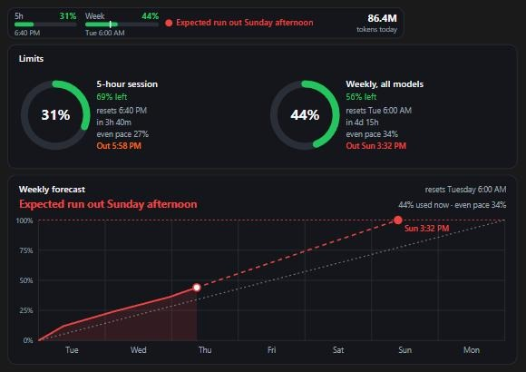

# usage-bar

A visual usage bar for Claude Code. It sits above your prompt and shows how much of your limits you have used, when you will run out at your current pace, and where your tokens went. One click shrinks it to a small gauge.



## What it shows

**The bar**

- 5-hour and weekly limits, with reset times and an even-pace marker
- A forecast of when you run out, such as "Expected run out Sunday afternoon"
- Tokens used today

**The forecast colours**

| Colour | Meaning |
| --- | --- |
| Green | You reach the reset, or later |
| Orange | You run out less than 24 hours before the reset |
| Red | You run out more than 24 hours before the reset |

The pace is your whole week so far, run forward from your last reading.

**The full view**

- A gauge for every limit, each with its own pace and run-out time
- A weekly forecast chart: the week so far, the even pace and where you are heading
- Tokens for today, this week, this month, this year and all time, split into this session and other sessions
- Each period compared with the same point in the one before
- Context used, session cost, last 5 hours, pace and daily average
- Averages and records: per reply, per session, busiest hour and weekday, active streak
- Today by the hour, day by day, months and years
- Input, output and cache tokens, models by period, top projects and top sessions
- A weekday by hour heatmap of when you use Claude

Numbers pick their own unit: `850K`, `50.2M`, `4.41B`.

## Install

At the prompt of a terminal session:

```
/plugin install usage-bar --marketplace KRish571215111/usage-bar
```

Answer `y` to add the marketplace, then pick a scope.

From a shell:

```bash
claude plugin install usage-bar --marketplace KRish571215111/usage-bar
```

In the desktop app, where `/plugin` does not run: click **+** next to the prompt box, then **Plugins**, **Add marketplace** with `KRish571215111/usage-bar`, then **Add plugin**.

**You need** Claude Code 2.1.317 or newer and [Node.js](https://nodejs.org) on your PATH. Node.js counts the tokens. The limits and forecast work without it.

## Use it

| Button | What it does |
| --- | --- |
| Gauge | Minimises the bar to the gauge. Click again to bring it back. |
| ⤢ | Opens the full view above the prompt |
| ✕ | Closes the full view back down to the gauge |

| Command | What it does |
| --- | --- |
| `/usage-bar disable` | Hides the bar and stops the background counting. It stays off in new sessions. |
| `/usage-bar enable` | Brings the bar back |
| `/usage-bar` or `/usage-bar details` | Opens the full details in a side pane |

To remove the plugin altogether:

```bash
claude plugin uninstall usage-bar
```

## Command line: `usage-bar status`

A read-only command that prints the last limit reading the bar saved, for scripts and for Claude Code itself. It reads a file. It never contacts Anthropic, never starts Claude Code, never uses any of your Claude usage, and never works out a percentage of its own.

### Where it comes from

Each time Claude Code hands the plugin new limits (with every reply), the plugin saves them to `status.json` in its data folder and puts the command beside it:

| File | What it is |
| --- | --- |
| `status.json` | The last reading: each window's percentage and reset time, and when it was read |
| `usage-bar.mjs` | The command (needs Node.js) |
| `usage-bar.cmd` | Runs it on Windows |

The data folder is `USAGE_BAR_CACHE_DIR` when that is set, else `%USERPROFILE%\.claude\usage-bar`. The files appear after the first reply in Claude Code with Usage Bar 1.3.0 or newer. They sit at the same path whatever plugin version you have.

### Run it in PowerShell

```powershell
& "$env:USERPROFILE\.claude\usage-bar\usage-bar.cmd" status --json
```

To type just `usage-bar` anywhere, add that folder to your PATH once: Start, search **Edit environment variables for your account**, select **Path**, **Edit**, **New**, paste the folder (`%USERPROFILE%\.claude\usage-bar`, or your `USAGE_BAR_CACHE_DIR`), then **OK** and open a new terminal. Then:

```powershell
usage-bar status --json
usage-bar status
usage-bar status --check-freshness
```

| Option | What it does |
| --- | --- |
| `--json` | JSON only, with nothing else on stdout |
| `--check-freshness` | Exit code `0` fresh, `1` stale or a window has reset, `2` no reading. In PowerShell, read it from `$LASTEXITCODE`. |
| `--max-age <seconds>` | How old a reading may be and still count as fresh (default `300`) |
| `--cache-dir <folder>` | Read `status.json` from another folder |

From macOS or Linux: `node ~/.claude/usage-bar/usage-bar.mjs status --json`.

### Example

```json
{
  "schema_version": 1,
  "generated_at": "2026-11-13T01:33:00+05:30",
  "snapshot_path": "C:\Users\you\.claude\usage-bar\status.json",
  "available": true,
  "five_hour": {
    "state": "current",
    "used_percent": 69,
    "remaining_percent": 31,
    "resets_at": "2026-11-13T04:40:00+05:30"
  },
  "weekly": {
    "state": "current",
    "used_percent": 80,
    "remaining_percent": 20,
    "resets_at": "2026-11-17T11:30:00+05:30"
  },
  "other": [],
  "missing": [],
  "awaiting_new_reading": false,
  "reading": {
    "updated_at": "2026-11-13T01:29:13+05:30",
    "age_seconds": 226,
    "fresh": true,
    "status": "fresh",
    "max_age_seconds": 300
  }
}
```

```
Usage Bar, last reading 3m ago (Fri 1:29 AM): fresh
5-hour: 69% used, 31% left, resets Fri 4:40 AM
Weekly: 80% used, 20% left, resets Tue 11:30 AM
```

Times are in your computer's timezone. Other windows Claude Code reports, such as a model's own weekly limit, are listed under `other`.

### Fresh, stale, reset and unavailable

The output is always a saved reading, never a live one. `reading.updated_at` says when it was taken and `reading.age_seconds` how long ago.

- **Fresh:** read within `--max-age` seconds.
- **Stale:** older than that. The numbers are still the last ones Claude Code sent. Send any message in Claude Code to refresh them.
- **Reset:** when a window's reset time passes before a new reading arrives, that window shows `"state": "expired"` with `used_percent` and `remaining_percent` set to `null`, the old figure under `last_reading`, and `awaiting_new_reading: true`. The command does not pretend you are at 0%: the real figure comes with the next reply. (The bar itself draws a reset window as 0% straight away.)
- **Unavailable:** `available: false`, with a `reason` and `message`. The reasons are `no_snapshot` (no reading saved yet), `corrupt_snapshot`, `unreadable_snapshot`, `unsupported_schema` and `no_windows`. A window Claude Code has not reported is `null` and named in `missing`.

### Limitations

- It is only as current as the last reply in a chat with Usage Bar. Usage on your phone, on the web or in chats without the plugin shows up after the next reply.
- `status.json` is replaced by renaming a finished file over it, so a reader never sees half a file.
- It needs Node.js on your PATH, as the token totals do.

## Where it works

| Surface | What you get |
| --- | --- |
| Desktop app | The bar, the full view and the pane, with charts |
| VS Code | The pane with charts. VS Code has no band above the prompt, so there is no bar. |
| Terminal | The bar and details as text. Terminals cannot draw the charts. |

## Good to know

- **Limits update with replies.** Claude Code gives a mod your limits only with each response. Chats with the mod share their readings, so the bar catches up after the next reply in any of them, and it tells you how old a reading is. Usage on your phone, on the web, or in chats opened before you installed the mod shows up late, so the numbers can briefly sit below the usage screen in Settings. Limits only exist on a subscription plan.
- **Token totals include cache reads**, which are usually most of the number.
- **Tokens are counted on this computer.** Usage on claude.ai or your phone counts towards your limits but not the token totals.
- **"All time" starts at your oldest transcript.** Claude Code cleans old transcripts away. Totals already counted stay, but anything cleaned before you installed this cannot be counted.
- **Times use your computer's timezone.**

## Privacy

Everything stays on your computer. The scanner reads your Claude Code transcripts in `~/.claude/projects` and keeps only numbers: token counts, hashed message ids, and project and session names. It does not keep message text, and it sends nothing anywhere.

The totals live in `~/.claude/usage-bar`. To keep them somewhere else, set the `USAGE_BAR_CACHE_DIR` environment variable to a folder.

`status.json` holds only your limit percentages, their reset times and when they were read: no messages, transcripts, account details, credentials or tokens. The `usage-bar` command only reads that file. It opens no network port and runs no other program.

## Develop

```bash
claude plugin validate .
claude plugin test .
node --test tests/cli.node-test.mjs
claude --plugin-dir .
```

## License

[MIT](LICENSE)
